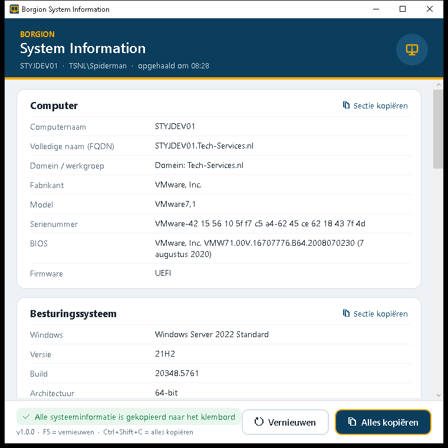

# Borgion System Information

Kleine Windows-applicatie in Borgion-stijl die de **algemene systeeminformatie van een pc** overzichtelijk toont
en met één klik **naar het klembord kopieert**, bijvoorbeeld om in een supportticket, e-mail of Teams-bericht te plakken.
Geen beheerdersrechten nodig, niets te configureren.



## Wat de app toont

| Sectie | Gegevens |
|---|---|
| **Computer** | Computernaam, FQDN, domein/werkgroep, fabrikant, model, serienummer, BIOS-versie, firmware (UEFI/BIOS) |
| **Besturingssysteem** | Windows-editie, versie (bijv. 24H2), build, architectuur, installatiedatum, laatst opgestart + uptime, laatste update, .NET Framework |
| **Hardware** | Processor (cores/threads), geheugen (totaal/vrij), videokaart, beeldscherm(en), vaste schijven (vrij/totaal), batterij |
| **Netwerk** | Per actieve adapter: IPv4, gateway, DNS, DNS-achtervoegsel, DHCP, MAC-adres, snelheid |
| **Gebruiker** | Aangemelde gebruiker, lokale beheerder (ja/nee), aanmeldserver, profielmap |
| **Regio en taal** | Weergavetaal, landinstellingen, datum-/tijdnotatie, tijdzone, toetsenbordindeling |
| **Beveiliging** | Antivirus (status), Windows Firewall per profiel, BitLocker op de systeemschijf, Secure Boot, UAC |

## Kopiëren

- **Alles kopiëren** (of `Ctrl+Shift+C`): alle secties als nette, uitgelijnde tekst.
- **Sectie kopiëren**: alleen die sectie.
- **Kopieer-icoon** per regel (zichtbaar bij aanwijzen): alleen die waarde, bijv. het serienummer of IP-adres.
- Waarden zijn ook met de muis te selecteren. `F5` haalt alles opnieuw op.

Voorbeeld van de gekopieerde tekst:

```text
Borgion System Information - PC-0123
Opgehaald: 6 november 2026, 08:27

== Computer ==
Computernaam                  : PC-0123
Domein / werkgroep            : Domein: borgion.local
Fabrikant                     : Dell Inc.
Model                         : Latitude 5440
Serienummer                   : 1AB2C34
...
```

## Installeren

1. Download de nieuwste `BorgionSystemInfo-x.y.z.zip` via [Releases](../../releases) en pak hem uit.
   De `.exe` kan ook los gestart worden, zonder installatie.
2. Open PowerShell **als administrator** in die map:
   ```powershell
   powershell -ExecutionPolicy Bypass -File .\Installeren.ps1
   ```
   Alleen een Startmenu-snelkoppeling, geen bureaubladicoon:
   ```powershell
   powershell -ExecutionPolicy Bypass -File .\Installeren.ps1 -GeenBureaublad
   ```
3. De app staat in `C:\Program Files\Borgion\SystemInformation` met een snelkoppeling
   **Borgion System Information** in het Startmenu en op het bureaublad van alle gebruikers.

Verwijderen: `Verwijderen.ps1` (als administrator).

### Uitrollen op meerdere werkplekken

- **GPO**: zet de uitgepakte map op een share en laat een computer-startupscript `Installeren.ps1` uitvoeren,
  of kopieer de `.exe` met *Group Policy Preferences → Files* en maak de snelkoppeling met *Shortcuts*.
- **Intune / RMM**: verpak de map als Win32-app met installatieopdracht
  `powershell -ExecutionPolicy Bypass -File Installeren.ps1` en verwijderopdracht
  `powershell -ExecutionPolicy Bypass -File Verwijderen.ps1`. Detectie: bestand
  `C:\Program Files\Borgion\SystemInformation\BorgionSystemInfo.exe`.

## Vereisten

- Windows 10/11 of Windows Server 2016+.
- .NET Framework 4.8 (standaard aanwezig in Windows 10 1903+ en Windows 11).
- Gewone gebruikersrechten. Alle gegevens worden lokaal gelezen (WMI, register, .NET); de app maakt geen
  netwerkverbindingen en slaat niets op.

## Zelf bouwen

```powershell
dotnet build src -c Release
# uitvoer: src\bin\Release\net48\BorgionSystemInfo.exe
```

Het icoon opnieuw genereren: `powershell -ExecutionPolicy Bypass -File tools\Make-Icon.ps1`.

Bij elke push naar `main` bouwt GitHub Actions de app. Verhoog `<Version>` in
`src/BorgionSystemInfo.csproj` om automatisch een nieuwe release te maken.

## Licentie

MIT, zie [LICENSE](LICENSE).
